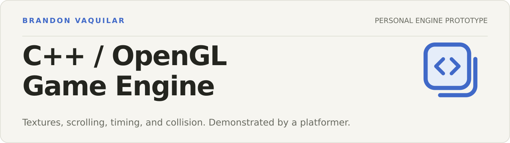
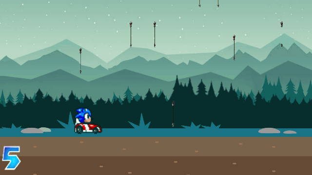
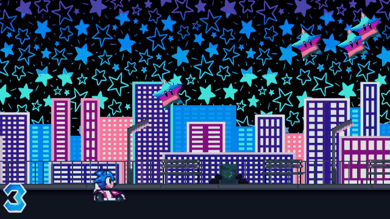
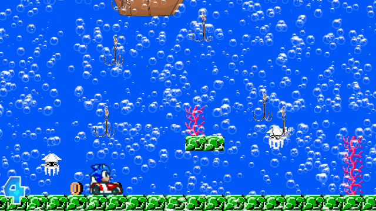

**A personal game engine prototype by Brandon Vaquilar, demonstrated by Blue Hedgehog Kart.**

[Demo GIFs](#platformer-demo-gallery) · [Build instructions](#build-and-run) · [Portfolio](https://brandonvaquilar.com)

A small 2D engine built with C++ and OpenGL, with shared systems for texture loading, layered background scrolling, timing, and circular collision detection. A kart-platformer demo integrates those systems with sprite animation, keyboard input, hazards, and three scenes. GLFW supplies the desktop window and input; SOIL loads image textures.

The engine is the main project; the platformer is its demonstration application. The shared `engine_core` library and the `platformer_demo` library have separate source and header folders. Both the desktop launcher and the offscreen capture runner use those same libraries.

## Engine systems

| System | Implementation | Demonstration |
| --- | --- | --- |
| Texture loading | `GLTexture`, with reuse of already loaded texture data | Player, backgrounds, and hazard textures |
| Layered scrolling | `GLParallax` | Forest, city, and underwater background layers |
| Timing | `GLTimer`, with monotonic milliseconds and a fixed-time capture mode | Animation, scrolling, and repeatable frame captures |
| Collision detection | `GLCheckCollision` circular overlap checks | Hazard contacts and the demo's life display |

The demo owns scene composition, sprite behavior, input mapping, hazards, and lives. This is an early engine prototype: scene composition and update/render separation are still being refined. A reusable sprite-animation component is a next step.

## Platformer demo gallery

These are five-second GIFs captured from the engine running the platformer demo. Each scene uses a different seeded, randomized mix of held movement, short left/right presses, releases, and idle periods. No installation is needed to view them.

### Forest



Several background layers scroll at different rates while falling arrows act as hazards. Circular overlap checks reduce the player's remaining lives after a hit.

### City



A separate set of background textures and rotating star hazards changes the scene's look and movement patterns.

### Underwater



The third scene combines vertical and horizontal layer movement with hook hazards. Each scene uses the same engine systems and demo player.

## Build and review features

- Separate CMake libraries for shared engine systems and the platformer demo.
- A GLFW desktop launcher with left/right keyboard movement through three environments.
- An optional Linux/Mesa capture runner that executes the same engine and demo without a desktop window.
- Reproducible screenshots and five-second GIFs, with [animation commands, input sequences, and final state](docs/images/animations.json).
- Automated checks for collision behavior, demo movement, scrolling, and deterministic timing.

The platformer demo currently supports left and right movement, hazards, five lives, and scene transitions. Jumping, attacks, lap timing, and a full racing system are future work.

## Build and run

The commands below target Ubuntu / Debian Linux.

```bash
sudo apt update
sudo apt install build-essential cmake libglfw3-dev libglu1-mesa-dev libsoil-dev freeglut3-dev libegl-dev libgl1-mesa-dri
git clone https://github.com/BrandonVaquilar/Blue-Hedgog-Kart-Platformer.git
cd Blue-Hedgog-Kart-Platformer
cmake -S . -B build -DCMAKE_BUILD_TYPE=Release
cmake --build build --parallel
ctest --test-dir build --output-on-failure
```

The verified build uses Linux, GCC, CMake, and Mesa. The desktop launcher requires an OpenGL-capable graphical session. Other desktop platforms need equivalent GLFW, OpenGL, GLU, GLUT, and SOIL development packages; they have not been verified here.

## Run the platformer demo

Run from the repository root:

```bash
./build/blue_hedgehog --level 0
```

| Input | Action |
| --- | --- |
| Left arrow / A | Move left |
| Right arrow / D | Move right |
| Escape | Quit |
| `--level 0`, `--level 1`, `--level 2` | Start in the forest, city, or underwater scene |
| `--help` | Show capture and window options |

The demo starts with five lives. Hazards consume lives on contact; reaching the right edge advances to the next scene. Losing all lives resets the character and life count.

## Regenerate demo GIFs without a desktop

```bash
sudo apt install python3-pil
python3 scripts/generate_animations.py
```

The animation script first holds Right for 180 fixed 60 Hz warmup frames to bring the kart into view, then records 300 simulation frames per scene. It exports every sixth framebuffer at 640×360 and encodes 50 samples at 10 fps into a five-second looping GIF, using a shared palette to limit flicker and file size. Seeds make the varied inputs reproducible. It verifies left movement, right movement, idle periods, scene selection, life bounds, and the encoded duration before saving the gallery.

The original full-size stills remain available for static previews. To regenerate them:

```bash
python3 scripts/generate_previews.py
```

The still-image script uses `build/blue_hedgehog_capture`, renders 240 fixed 60 Hz frames in each scene with Right held, and reads the actual OpenGL framebuffer. Pillow only converts the image format. Both capture paths use the same engine libraries as the desktop launcher.

For a single capture:

```bash
LIBGL_ALWAYS_SOFTWARE=1 ./build/blue_hedgehog_capture --demo --frames 240 --level 0 --screenshot build/forest.ppm --state build/forest.json
```

The capture target is built on Linux when EGL is available. It uses Mesa's surfaceless platform and needs no X server, browser, or running desktop.

For custom recordings, `--input-script FILE` accepts exactly one direction (`-1` for left, `0` for released/idle, `1` for right) per simulation frame. `--frame-directory DIR` writes numbered PPM images and corresponding gameplay-state JSON. `--capture-every N` sets the export interval without changing the simulation rate. Malformed inputs or a script with the wrong frame count are rejected.

## Source organization

| Path | Purpose |
| --- | --- |
| `include/engine/`, `src/engine/` | Shared texture, parallax, timing, and collision systems; no demo dependency |
| `include/demo/`, `src/demo/` | Platformer scene composition, player animation, input mapping, hazards, and helper classes |
| `src/main.cpp` | Desktop input and render loop |
| `src/capture_main.cpp`, `src/app/` | Capture options, framebuffer output, and offscreen context |
| `assets/images/` | Bundled demo art |
| `tests/` | Collision, movement, timing, and scrolling checks |
| `scripts/`, `docs/images/` | Reproducible previews and committed results |

Generated build files stay in `build/`. Texture data is reused when hazards respawn, scrolling state is initialized, and timing uses monotonic milliseconds instead of platform-dependent CPU ticks.

To extend the engine, work in `include/engine/` and `src/engine/`; engine code does not include demo headers. Demo rules and presentation belong in `include/demo/` and `src/demo/`. The two launchers share the demo library so screenshots exercise the same implementation as the desktop application.

## Next steps

- Separate simulation updates from rendering more fully.
- Make scene composition easier to reuse across demonstrations.
- Extract sprite animation from the demo into an engine component.
- Expand the platformer demo with jumping and more platform interactions.

## Assets and references

Character and background art are bundled existing assets and are not presented as original artwork. Their creators retain their rights; this repository does not grant a separate license for third-party art.

- [GLFW documentation](https://www.glfw.org/docs/latest/)
- [Mesa EGL documentation](https://docs.mesa3d.org/egl.html)
- [Khronos OpenGL reference](https://registry.khronos.org/OpenGL/)
